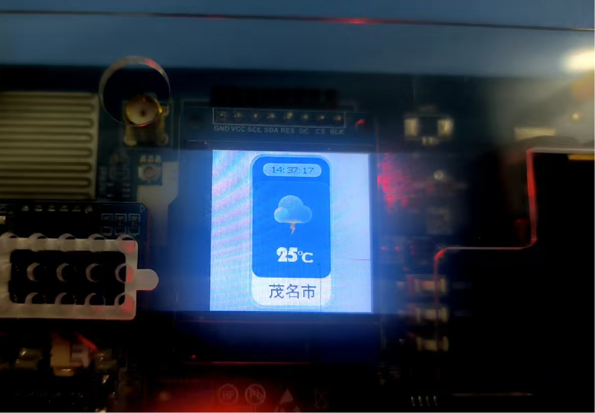
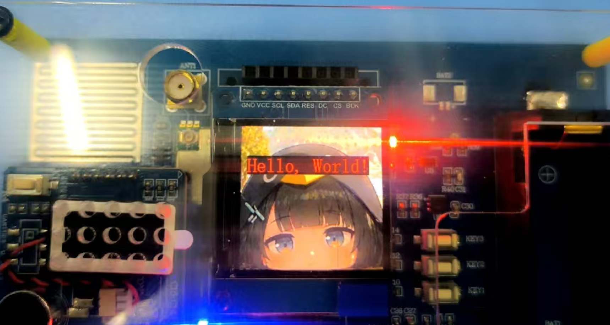
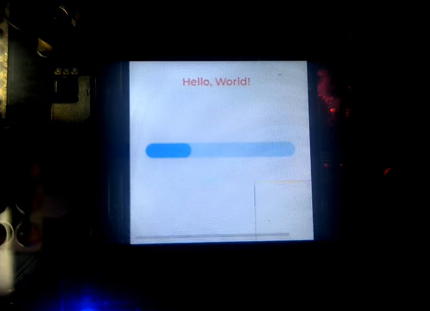

# 基于ESP32的LVGL心知天气显示摆件
🌦基于 ESP32 + FreeRTOS + LVGL 实现的桌面天气显示屏，通过IP自动定位城市，调用心知天气API获取实时温度与更新时间，LCD屏幕图形化展示。

## 项目简介
本项目使用 ESP-IDF 开发，依托 FreeRTOS 事件组完成 WiFi、HTTP 任务同步；通过 IP 接口自动识别所在城市，请求心知天气实时气象数据，借助 LVGL 图形库绘制天气界面，定时刷新城市、实时温度、数据更新时间。
- RTOS 机制：事件组同步、任务阻塞延时、多任务并发；
- 网络功能：ESP HTTP Client 发起HTTPS请求，cJSON解析天气JSON数据；
- 图形界面：LVGL 自定义字体、纯色背景标签、多文本组件布局；
- 存储：NVS Flash 初始化适配ESP32标准工程。

### 成品预览


## LVGL调试
### 图片渲染
前期验证屏幕图片显示驱动，测试图片加载、像素渲染功能：


### 组件测试
搭建文本标签、字体、背景色样式，完成界面基础控件调试：


## 硬件需求
- ESP32 主控模块
- LCD 显示屏（配套板载LVGL驱动）
- 电源、排线等外设

## 环境依赖
1. ESP-IDF 开发环境
2. FreeRTOS（ESP-IDF内置）
3. LVGL 图形库
4. cJSON JSON解析库
5. 心知天气 API Key（自行申请替换）

## 快速编译烧录
1. 克隆本仓库
2. 修改代码内 `WEATHER_PRIVATE_KEY` 为你自己申请的心知天气密钥
3. 配置WiFi账号密码（wifi_sta.h文件内）
4. 补全城市文本字库，解除IP定位代码注释
5. 编译、烧录、串口监视
```bash
idf.py set-target esp32
idf.py build flash monitor
```

## 功能说明
1. 上电自动初始化NVS、WiFi；
2. FreeRTOS事件组等待WiFi连接成功后再发起网络请求；
3. 先调用IP定位接口自动获取城市名称；
4. 使用城市名请求心知天气实时温度、数据更新时间；
5. LVGL 创建城市、温度、时间三个文本标签，2秒周期刷新界面；
6. HTTP分片接收处理，兼容chunked分块返回数据。

## 代码RTOS核心机制
1. **事件组 EventGroup**
   - `s_wifi_ev`：WiFi连接完成同步信号
   - `s_client_http_event`：HTTP数据接收完成通知
2. 任务阻塞延时 `vTaskDelay`，无空轮询，低CPU占用；
3. app_main 为主任务循环刷新UI，WiFi、HTTP为独立逻辑流程。